# Post-contenido — Unidad 6: MVC Formal con Front Controller, Sesiones, Roles e i18n

## Información del Estudiante
* **Nombre:** Andrea Valentina Rivera Fernández
* **Código:** 1152444
* **Institución:** Universidad Francisco de Paula Santander (UFPS)
* **Carrera:** Ingeniería de Sistemas
* **Materia:** Programación Web
* **Unidad:** 6
* **Año:** 2026

## Descripción

Repositorio del laboratorio de la Unidad 6 de Programación Web. Contiene un
único proyecto Maven Web (`gestor-tareas-mvc`) que formaliza el patrón MVC
con un Front Controller y el patrón Comando, extendido con autenticación por
sesión con roles, validación por campo e internacionalización.

**Tecnologías:** Java, Jakarta Servlet 6.0, JSP, JSTL 3.0, Maven y Apache
Tomcat 10.1.

## Parte 1 — Front Controller y patrón Comando

`FrontControllerServlet` es el único punto de entrada (`/app`) y delega en
objetos `Comando` (`ListarComando`, `FormularioComando`, `GuardarComando`,
`EliminarComando`, `CompletarComando`). `TareaService` y `TareaDAO` separan
la lógica de negocio y el acceso a datos del Controlador. Las vistas usan
JSTL y Expression Language, sin scriptlets. Las operaciones que modifican
datos terminan con un redirect (Post/Redirect/Get).

## Parte 2 — Sesión con roles, validación por campo e i18n

`FrontControllerServlet` centraliza la verificación de sesión antes de
resolver cualquier comando protegido. `LoginComando` y `LogoutComando`
gestionan `HttpSession` con roles ADMIN/USER; `EliminarComando` solo permite
el rol ADMIN. `GuardarComando` valida cada campo por separado, con mensajes
específicos y repoblado del formulario, usando el límite de longitud del
título leído del contexto de aplicación (`web.xml`). `IdiomaComando` guarda
la preferencia de idioma en una Cookie, leída en las vistas con el objeto EL
implícito `cookie` y `ResourceBundle` (`messages*.properties`).

## Estructura del proyecto

```
rivera-post1-u6/
├── pom.xml
├── README.md
├── capturas/
└── src/main/
    ├── java/com/ejemplo/mvc/
    │   ├── model/        Tarea, TareaDAO, Usuario, UsuarioDAO
    │   ├── service/      TareaService, AutenticacionService
    │   └── controller/
    │       ├── FrontControllerServlet.java
    │       └── comando/  Comando y los 8 comandos
    ├── resources/        messages.properties, messages_en, messages_es
    └── webapp/
        ├── index.jsp
        ├── css/estilos.css
        └── WEB-INF/
            ├── web.xml
            └── views/    lista.jsp, formulario.jsp, login.jsp
```

## Decisiones de diseño

- **El Comando devuelve la vista, no hace el forward.** Cada comando retorna
  la ruta de la vista (o `null` si ya resolvió la respuesta con un redirect).
  Así el `forward` está en un solo lugar, `FrontControllerServlet.procesar()`,
  en vez de repetirse en cada comando, y el controlador puede aplicar lógica
  común después de ejecutarlos.
- **Front Controller en vez de un Servlet por acción.** Al haber un único
  método por el que pasa toda petición, la verificación de sesión de la Parte 2
  se escribió una sola vez. Con un Servlet por acción habría que copiarla en
  cada uno; aquí un comando nuevo queda protegido automáticamente.
- **Verificación de sesión centralizada.** Solo `login` e `idioma` son
  públicos (conjunto `PUBLICOS`). Cualquier otro comando sin sesión redirige
  a `/app?comando=login`.
- **Usuario y rol en HttpSession; idioma en Cookie.** El usuario y su rol
  deben desaparecer al cerrar o expirar la sesión por seguridad. El idioma
  debe sobrevivir al cierre de sesión, para que incluso la pantalla de login
  se muestre en el idioma elegido, por lo que va en una Cookie de 30 días.
- **Validación por campo con repoblado.** `GuardarComando` acumula los errores
  en un `LinkedHashMap` y devuelve el formulario con un mensaje junto a cada
  campo y los valores ya ingresados, para que el usuario no tenga que
  reescribirlos.
- **Longitud máxima del título en el contexto de aplicación.** El límite no
  es un literal en `GuardarComando`: viene del `context-param`
  `app.maxLongitudTitulo` de `web.xml`, cargado una sola vez en `init()`. Se
  puede cambiar sin recompilar.
- **Restricción de rol en EliminarComando.** Solo ADMIN puede eliminar; un
  USER recibe un mensaje y la tarea no se borra.
- **messages_en.properties explícito.** Se incluye además del archivo por
  defecto, para que el inglés no dependa del idioma del sistema operativo.
- **URI de JSTL.** Se usan `jakarta.tags.core` y `jakarta.tags.fmt`, las URI
  de JSTL 3.0 para Jakarta EE 10.

## Prerrequisitos

- JDK 17 o superior
- Maven 3.8+
- Apache Tomcat 10.x (puerto 8080 libre)
- IntelliJ IDEA (recomendado) y Git

## Cómo compilar y ejecutar

1. Clonar el repositorio:
   ```
   git clone https://github.com/Andrea-Rivera31/rivera-post1-u6.git
   ```
2. Abrir la carpeta como proyecto Maven en IntelliJ IDEA.
3. Compilar:
   ```
   mvn clean package
   ```
4. Configurar Tomcat Server (Local) con Tomcat 10.1, desplegar el artefacto
   `gestor-tareas-mvc:war exploded` con contexto `/gestor-tareas-mvc`.
   Alternativa manual: copiar `target/gestor-tareas-mvc.war` a `webapps` de
   Tomcat y ejecutar `bin/catalina.sh run`.
5. Abrir http://localhost:8080/gestor-tareas-mvc/app

**Usuarios de prueba:**

| Usuario | Contraseña | Rol |
|---|---|---|
| admin | Admin123! | ADMIN |
| maria | Maria2026! | USER |

## Capturas de pantalla

### Parte 1

Compilación exitosa:

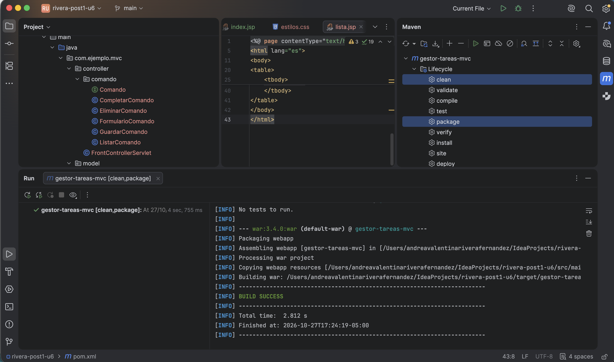

Listado inicial con las 3 tareas (sin pasar `comando`):

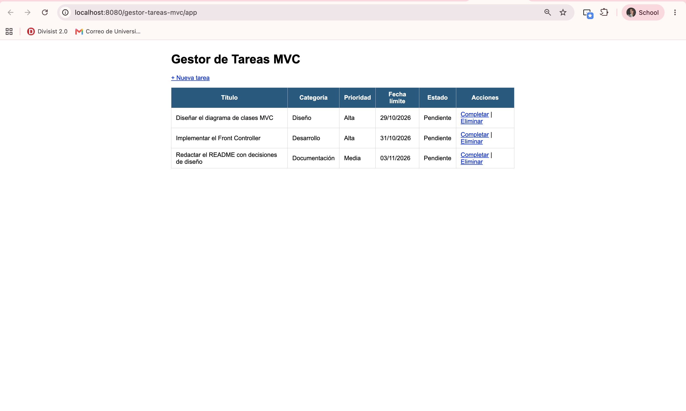

Tarea guardada (la URL cambia a `?comando=listar`, redirect POST-GET):

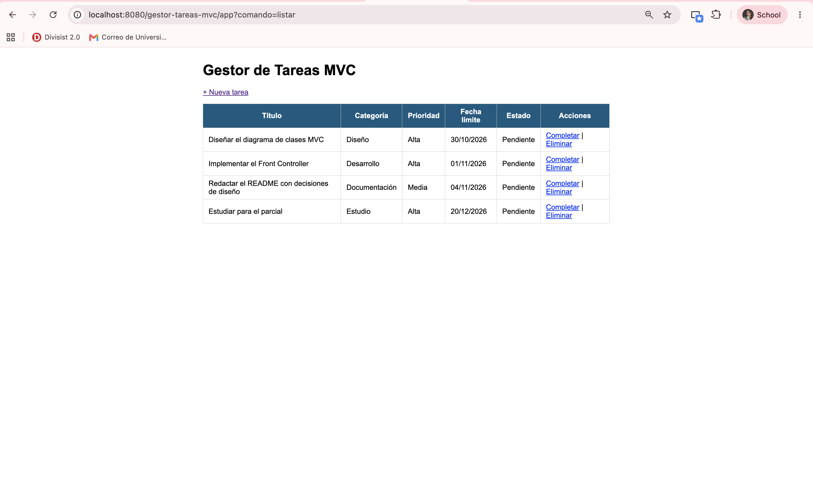

Tarea completada:

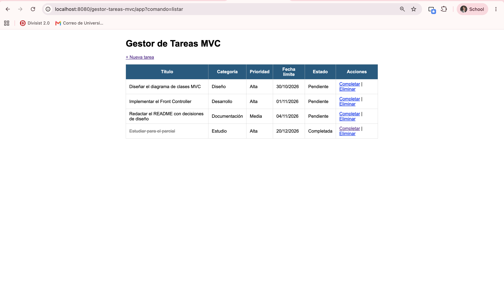

Confirmación antes de eliminar:

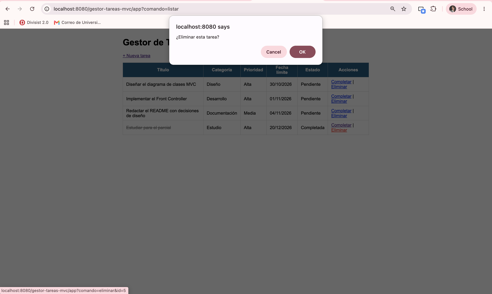

Historial de commits de la Parte 1:

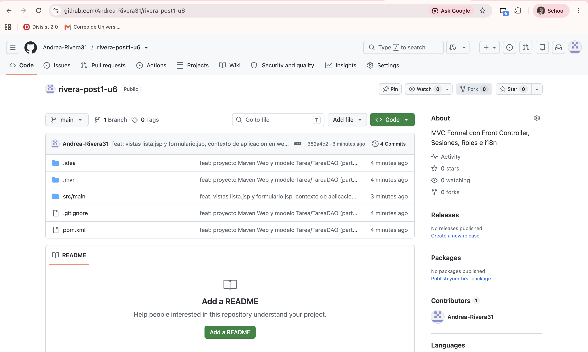

### Parte 2

Compilación exitosa:

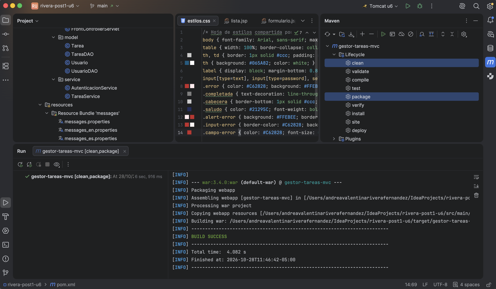

Redirección al login sin sesión:

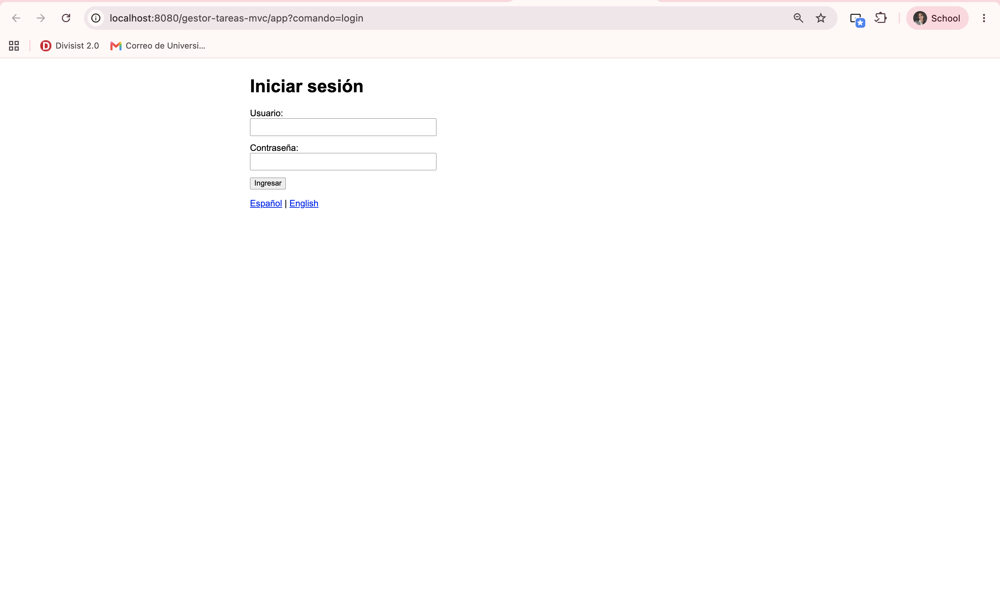

Login con credenciales incorrectas:

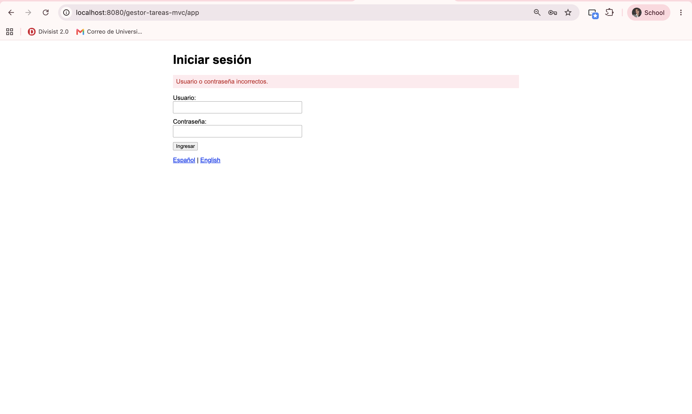

Listado con sesión de ADMIN:

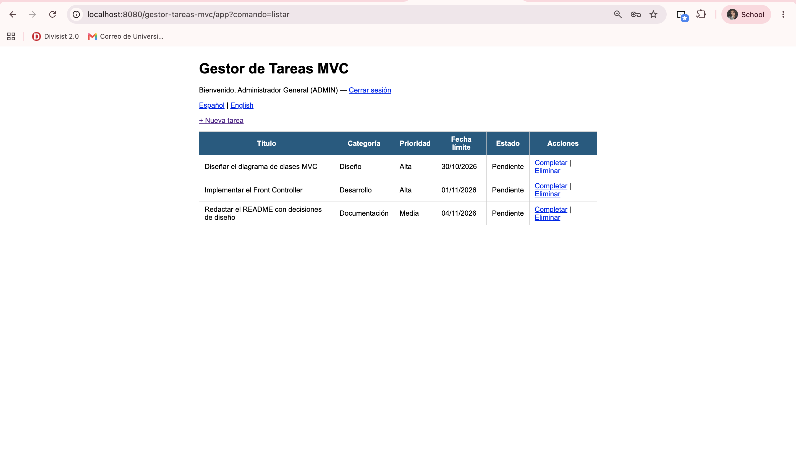

Restricción de rol al eliminar (USER):

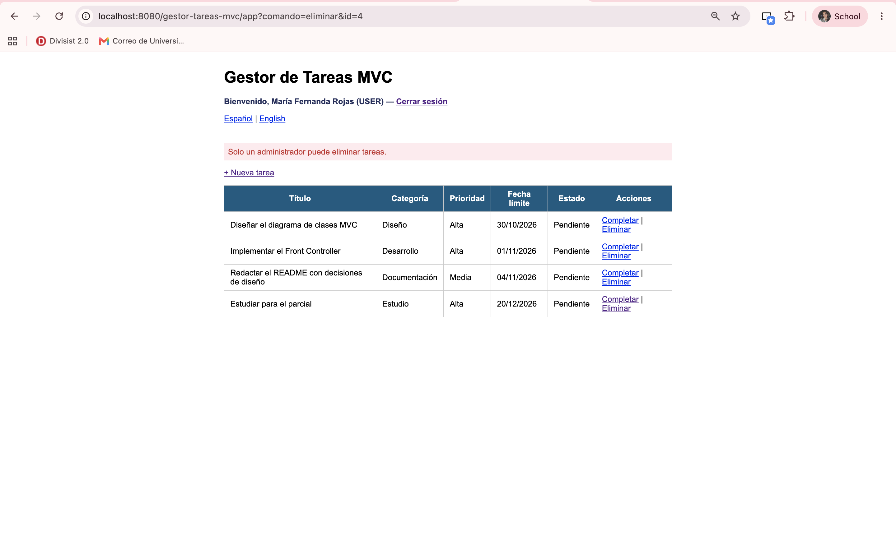

Formulario con validación por campo y repoblado:

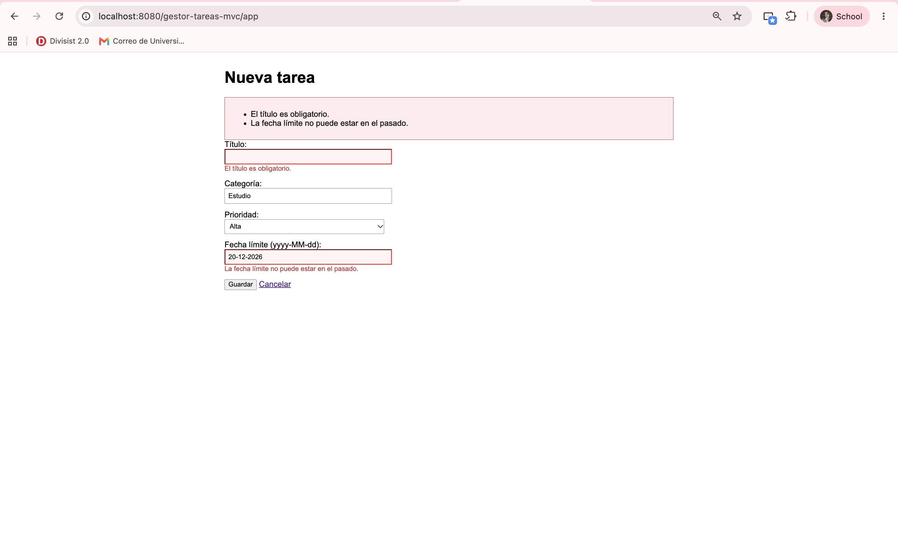

Selector de idioma (inglés):

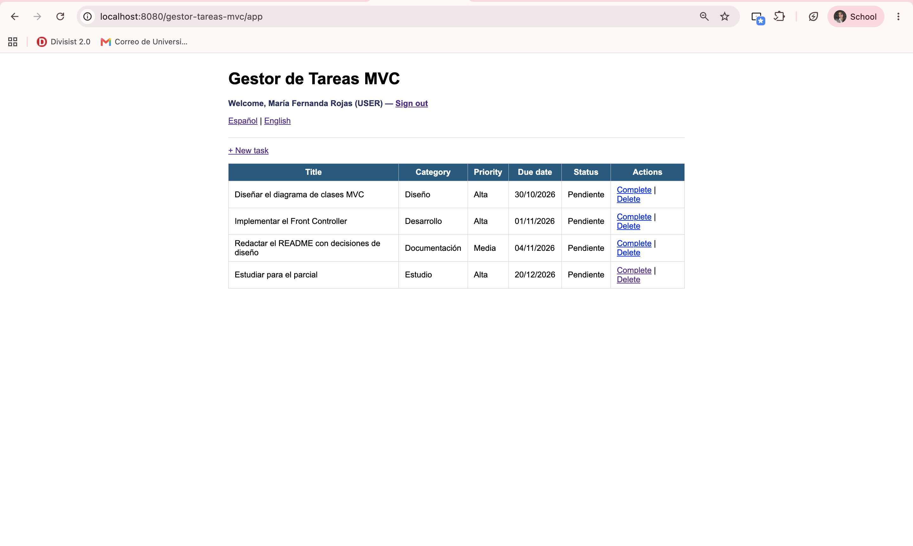

Login en inglés tras cerrar sesión (idioma persistido en cookie):

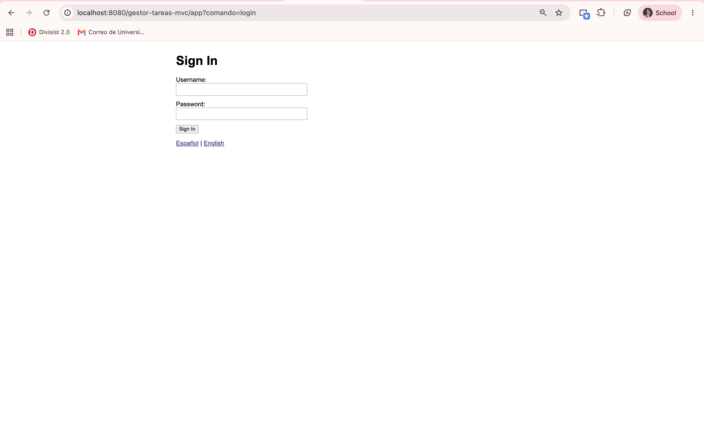